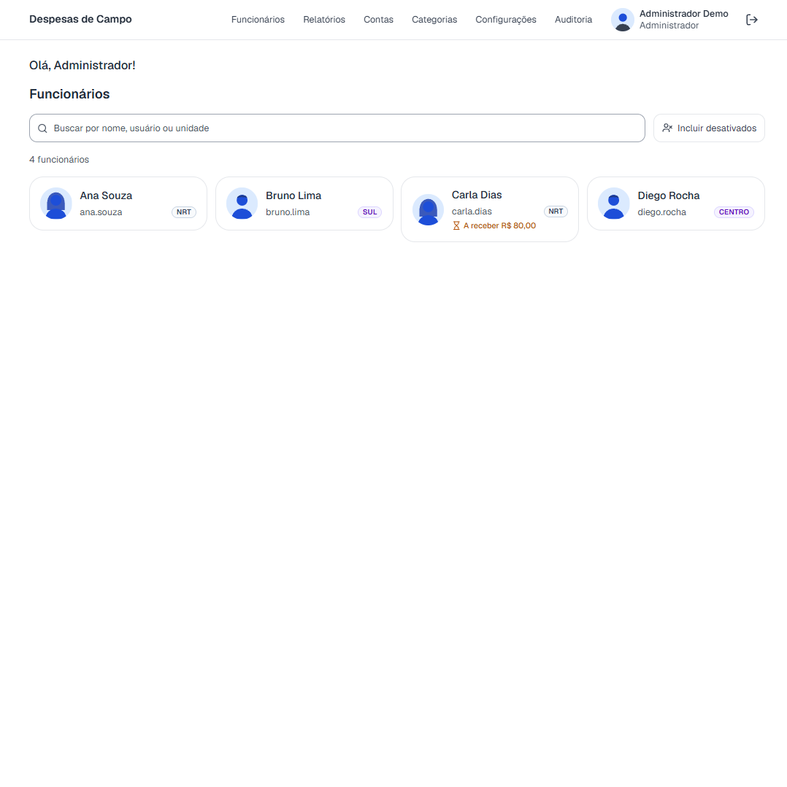
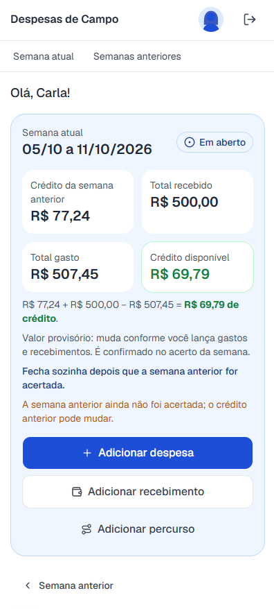
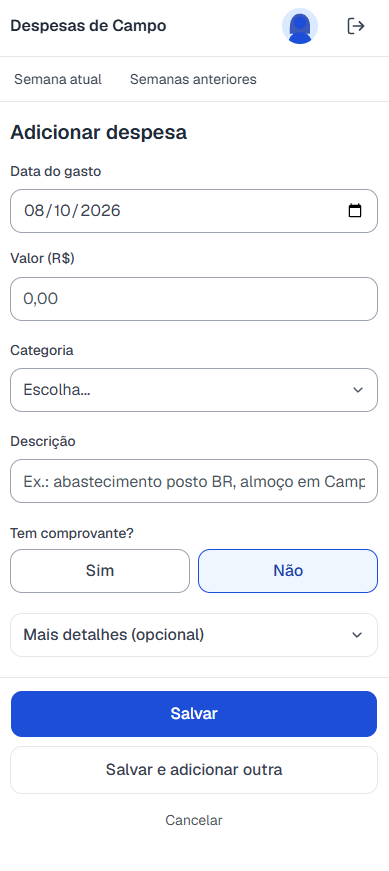
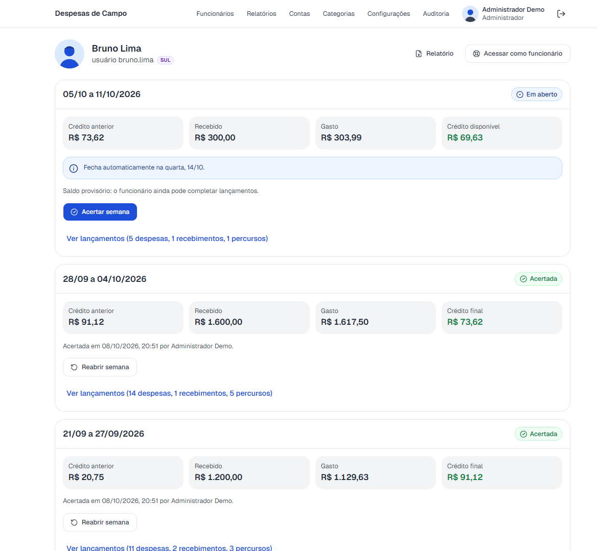
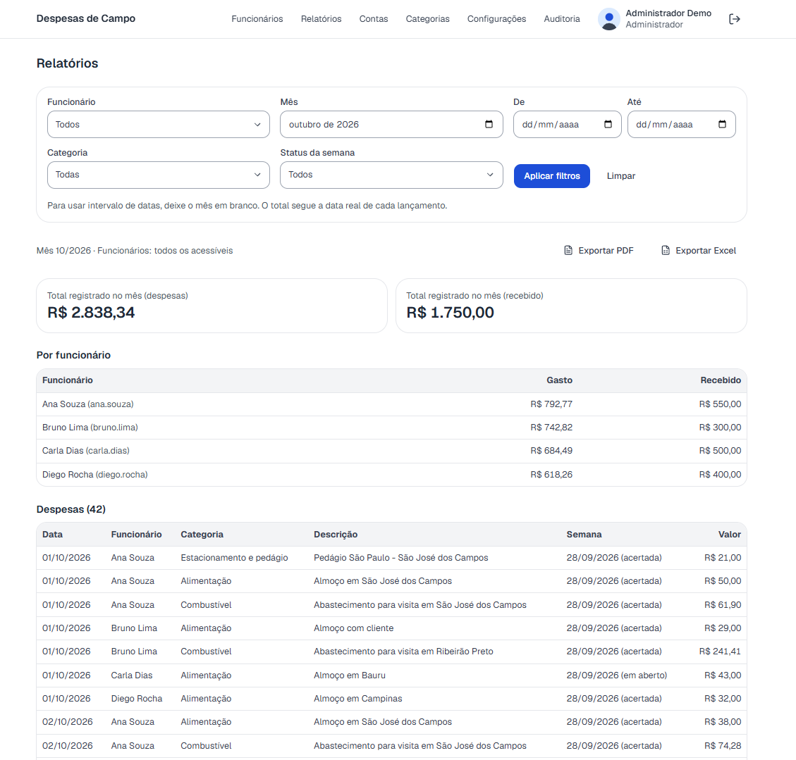
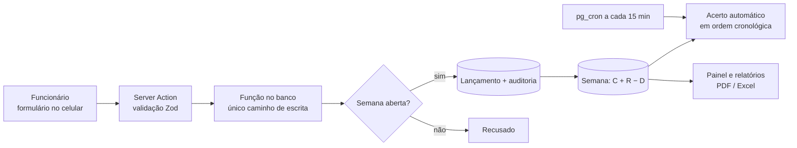
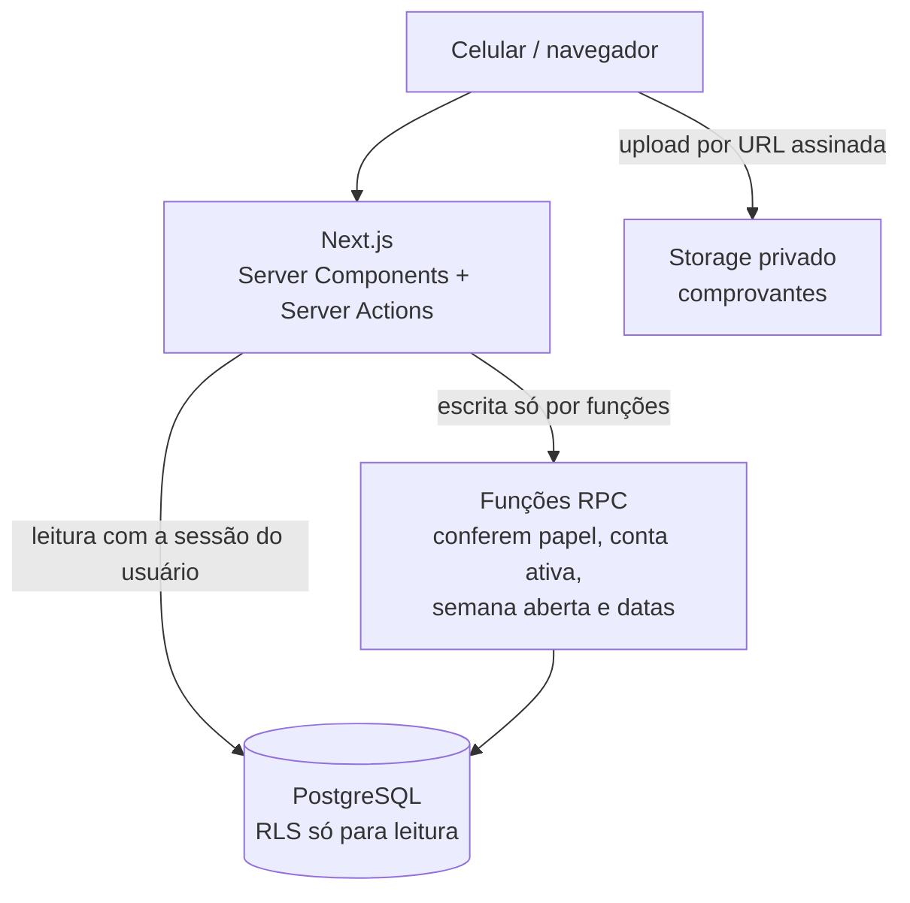

# Relatório Semanal

Sistema web para equipes de campo lançarem despesas e valores recebidos pelo celular, com **acerto semanal automático** e relatórios para a administração.



## Contexto

Funcionários que trabalham em campo gastam com combustível, alimentação, pedágio e hospedagem, e recebem adiantamentos da empresa para cobrir esses gastos. O controle era feito em **planilhas de Excel** preenchidas por cada um e enviadas à administração. Na prática, muitos relatórios simplesmente não chegavam, chegavam incompletos ou com erro de soma, e a conta de quanto cada um tinha de crédito, ou de quanto a empresa ainda devia, era refeita à mão toda semana.

O Relatório Semanal substitui a planilha por um formulário simples no celular. Cada despesa é lançada na hora, com foto do comprovante, e o sistema faz a conta da semana sozinho:

> crédito da semana anterior + recebido − gasto = **crédito** que fica com o funcionário, ou **valor a receber** da empresa

## O que o sistema faz

**Para o funcionário (celular)**
- Lançar despesa (data, valor, categoria, descrição) com **foto ou PDF do comprovante**, inclusive fotos HEIC do iPhone, convertidas no próprio aparelho.
- Lançar valores recebidos (transferência, cartão benefício) e percursos opcionais, com km e clientes visitados.
- Ver a conta da semana escrita por extenso e o que falta receber da empresa.
- Consultar as semanas anteriores já encerradas.

**Para a administração (computador)**
- Painel com todos os funcionários, selo da unidade e aviso de quem tem valor a receber.
- Detalhe semana a semana: crédito anterior, recebido, gasto e resultado.
- **Acerto automático:** a semana sem pendência fecha sozinha depois de uma tolerância configurável; a semana em que a empresa deve fica aberta até o recebimento ser lançado e então fecha sozinha. Acerto manual e reabertura (com motivo obrigatório) continuam disponíveis.
- Relatórios com filtros por funcionário, mês, intervalo, categoria e status, com **exportação em PDF e Excel**.
- Contas, categorias, configurações, auditoria completa e "Acessar como funcionário" para dar suporte, com tudo registrado em nome de quem acessou.

| | |
|---|---|
|  |  |
| Semana atual no celular, com a conta por extenso | Lançamento de despesa |
|  |  |
| Semanas do funcionário na administração | Relatórios com exportação em PDF e Excel |

## Resultado

O sistema é usado por **entre 20 e 30 funcionários de campo** e por **três pessoas na administração**, que acompanham a operação, dão suporte quando falta dinheiro a alguém e analisam os relatórios. A principal mudança foi a **adesão**: antes faltavam muitos relatórios, e hoje o lançamento é simples o bastante para ser feito na hora, pelo celular, e o acerto da semana sai sem conta manual.

## Stack e arquitetura

- **Next.js 16** (App Router, Server Components, Server Actions) + **React 19** + **TypeScript**
- **shadcn/ui** (Radix) + **Tailwind CSS 4**, com alvos de toque de 44 px para uso no celular
- **React Hook Form** + **Zod** nos formulários e **TanStack Query** no cliente
- **Supabase**: PostgreSQL com Row Level Security, Auth, Storage privado e **pg_cron** (acerto automático)
- **jsPDF** e **ExcelJS** para as exportações
- **Vitest** (unidade), testes de banco em SQL e **Playwright** (ponta a ponta)





Modelo de dados, cálculo, permissões e fluxos: [docs/arquitetura.md](docs/arquitetura.md). Uso e operação: [docs/manual.md](docs/manual.md).

## Decisões técnicas

**1. Escrita só por funções no banco.** Os usuários autenticados não têm permissão de INSERT, UPDATE ou DELETE em nenhuma tabela. Toda gravação passa por funções que conferem papel, conta ativa, semana aberta e datas, e o RLS cuida apenas da leitura. Gatilhos repetem o bloqueio de semana acertada como segunda barreira. Assim, mesmo uma chamada direta à API do banco não consegue contornar as regras de negócio.

**2. Concorrência entre acerto e lançamento.** Cada lançamento atualiza a versão da semana, o que trava a linha, e o acerto usa `SELECT … FOR UPDATE` na mesma linha. Um lançamento que chega durante o acerto espera e é recusado depois; se chegou antes, entra na soma. O acerto também confere a versão vista na tela e recusa se a semana mudou. Esse cenário tem um teste automatizado com duas conexões simultâneas.

**3. Acerto automático agendado no próprio banco.** Uma rotina do pg_cron roda a cada 15 minutos e acerta, em ordem cronológica, as semanas terminadas há mais que a tolerância, sem alterações recentes e sem valor a receber. Ela para na primeira semana com pendência, para não fechar uma semana com base num crédito que ainda pode mudar. A regra vive no banco, então vale mesmo que ninguém abra o sistema.

Outros cuidados: valores sempre em centavos (inteiros), exportação para Excel com o texto do usuário neutralizado contra injeção de fórmulas, limite de tentativas de login por usuário e por IP, comprovantes enviados direto ao Storage por URL assinada e lidos por URLs que expiram em 60 segundos.

## Como rodar

Pré-requisitos: **Node.js 20.9+** e **Docker Desktop** (para o Supabase local).

```bash
npm install
npx supabase start          # Supabase local; aplica as migrations (inclui o pg_cron)
cp .env.example .env.local  # preencha com os valores de `npx supabase status`
npm run seed                # equipe fictícia com seis semanas de uso simulado
npm run dev                 # http://localhost:3000
```

Usuários criados pelo seed (senha `Demo12345`, a mesma para todos):

| Usuário | Papel |
|---|---|
| `admin` | Administrador |
| `gestor` | Gestor |
| `ana.souza`, `bruno.lima`, `diego.rocha` | Funcionários com semanas acertadas e crédito |
| `carla.dias` | Funcionária com R$ 80,00 a receber da empresa |

Para recomeçar do zero: `npx supabase db reset` e `npm run seed`.

**Testes:**

| Comando | O que verifica |
| --- | --- |
| `npm run typecheck` | Tipos (inclui os tipos de rota do Next) |
| `npm run lint` | ESLint (inclui as regras do React Compiler) |
| `npm test` | Unitários: dinheiro em centavos, semanas e fuso, CPF, validação, exportação sem fórmulas, mensagens do acerto |
| `npm run test:db` | Banco: 95 casos de regras, RLS e autorização, mais a concorrência entre acerto e lançamento |
| `npm run test:e2e` | Ponta a ponta no navegador |

Os testes de banco rodam dentro de transações desfeitas ao final, então nenhum dado de teste permanece.

## Status

Versão demonstrativa de um sistema em produção, com dados fictícios.
